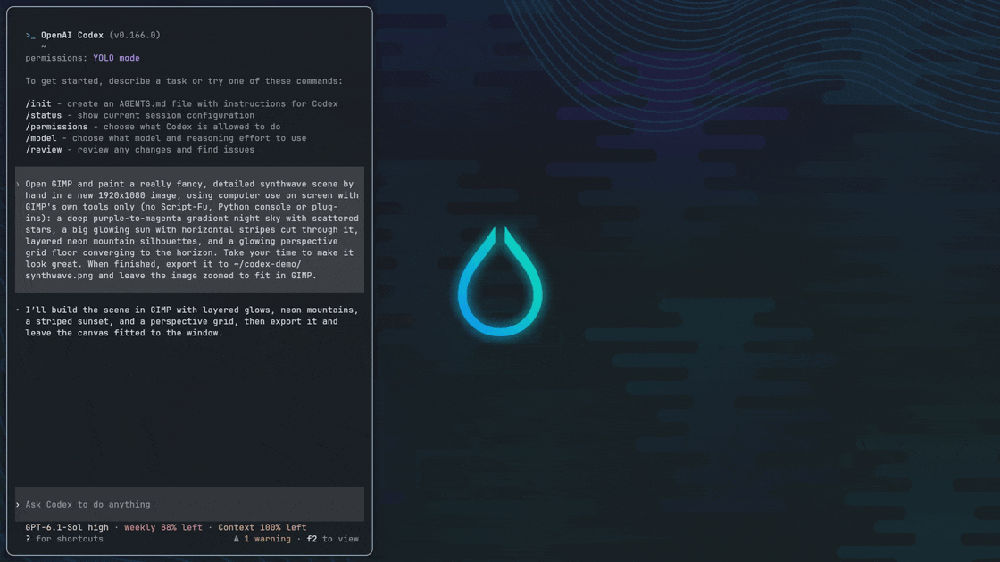

# codex-computer-use-hyprland

Computer use for [Codex](https://github.com/openai/codex) on [Hyprland](https://hypr.land).
Codex sees and operates native Linux apps the way it does on macOS, in the
background, while you keep using your desktop.



<sub>Codex (left) paints a synthwave scene with GIMP's own tools: gradients, selections, brushes and layers.</sub>

## What you get

- **The macOS API.** Codex uses its own `cua_repl` tool: `cua.getApp("Calculator")`,
  accessibility-tree diffs, `click`, `typeText`, `setValue`, rich `paste`,
  `scroll`, `drag`, menus and dialogs. Prompts and skills written for macOS work
  as they are.
- **Background input.** A small Hyprland plugin delivers events straight to the
  target window, including windows on hidden workspaces, so you can keep working
  alongside the agent.
- **Real apps.** An end-to-end suite covers GTK 3/4, Qt 6, Chromium, Firefox,
  LibreOffice, terminals and X11 apps via XWayland, and runs on every new Codex
  and Hyprland release.

## Install

Requirements: Arch Linux (or similar), Hyprland 0.56+, the Codex CLI, and the
ChatGPT desktop package (`chatgpt-bin` from OpenAI's repository or
`chatgpt-desktop` from the AUR), which provides the computer-use runtime.

```sh
git clone https://github.com/Ahmad-A0/codex-computer-use-hyprland ~/.local/share/codex-computer-use-hyprland
~/.local/share/codex-computer-use-hyprland/scripts/update.sh --enable
```

This installs the latest release, registers the provider in `~/.codex/config.toml`
and checks for updates hourly. Start a new Codex session and ask it to use an app.
`codex-computer-use-hyprland doctor` checks the setup.

## How it works

OpenAI's computer-use runtime (`cua_repl`) talks to a platform backend called Sky.
This project supplies a Hyprland backend: AT-SPI provides the accessibility tree
and element actions, and a compositor plugin captures window screenshots and
sends input to a specific window's Wayland surface. The provider builds a patched
copy of the runtime locally from your own ChatGPT install.
[docs/DESIGN.md](docs/DESIGN.md) has the details, and [docs/USAGE.md](docs/USAGE.md)
covers settings, updates and uninstalling.

## Limitations

- Drag and drop between Wayland and XWayland windows is unsupported.
- Terminals are driven from screenshots, since they expose no accessibility tree.
- Computer-audio recording is unsupported.

## License

MIT.
