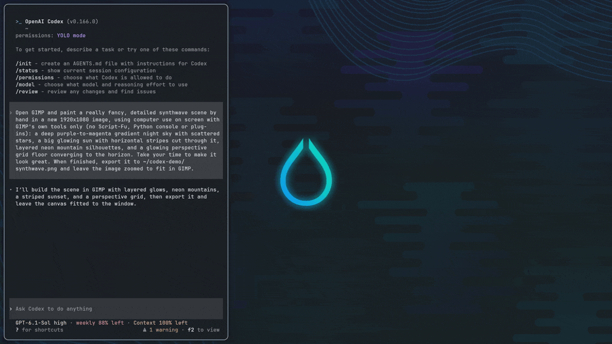

# codex-computer-use-hyprland

A Hyprland backend for [Codex](https://github.com/openai/codex) computer use.
Codex drives native Linux apps through the same `cua_repl` API it uses on macOS,
and it does so in the background: input goes to the target window only, so your
cursor, keyboard focus and current workspace are left alone.



<sub>Codex (left) paints in GIMP with GIMP's own tools while the desktop stays usable.</sub>

## Status

Works with GTK 3/4, Qt 6, Chromium, Electron, Firefox, LibreOffice, terminals,
and X11 apps under XWayland. An end-to-end suite drives real apps through the
real `cua_repl` server in a disposable Arch VM. It runs on every push and
whenever a new ChatGPT/Codex or Hyprland package appears; the last versions it
passed with are recorded in [`upstream.json`](upstream.json).

Known gaps:

- No drag and drop between a Wayland window and an XWayland window.
- Terminals expose no accessibility tree, so they are driven from screenshots
  and coordinates.
- No computer-audio recording.
- `getApp` binds one window, not a whole app as on macOS.

[DESIGN.md](docs/DESIGN.md#remaining-parity-gaps) lists the finer ones.

## Install

You need:

- Arch Linux or similar, with Hyprland 0.56 or newer
- the Codex CLI
- the ChatGPT desktop package (`chatgpt-bin` from OpenAI's repository or
  `chatgpt-desktop` from the AUR), which ships the computer-use runtime
- a C++23 compiler and Hyprland's development headers, to build the compositor
  plugin
- `uv`, `grim`, `python-gobject`, `at-spi2-core` and `python-pillow`

### As a Codex plugin

```sh
codex plugin marketplace add Ahmad-A0/codex-computer-use-hyprland
codex plugin add hyprland-computer-use@codex-computer-use-hyprland
```

Start a new Codex session and ask it to use an app. The first start takes about
30 seconds: it installs the latest release into
`~/.local/share/codex-computer-use-hyprland` and enables hourly updates. The
plugin replaces the `cua_repl` in OpenAI's bundled computer-use plugin, browser
use included.

### From a clone

```sh
git clone https://github.com/Ahmad-A0/codex-computer-use-hyprland ~/.local/share/codex-computer-use-hyprland
~/.local/share/codex-computer-use-hyprland/scripts/update.sh --enable
```

This registers one `cua_repl` entry in `~/.codex/config.toml` (the original is
backed up) and follows new releases hourly.

### Check the setup

```sh
~/.local/share/codex-computer-use-hyprland/doctor
```

`doctor` checks the runtime, the compositor plugin, accessibility and the
registration.

## How it works

```text
Codex → cua_repl (OpenAI's runtime) → Sky client            session sandbox
                                         │ native pipe
                                      sky-broker            outside the sandbox
                                         │
                                      sky-hyprland
                                         │
                Hyprland plugin · AT-SPI · XInput2
```

OpenAI's runtime talks to a per-platform backend called Sky. This project
supplies the Hyprland one:

- **Accessibility tree and element actions** come from AT-SPI. The provider
  turns on the session accessibility flag, as a screen reader would, so that
  Chromium, Electron and Firefox expose their UI.
- **Screenshots and input** come from a small Hyprland plugin (C++). It captures
  a single window, including one on a hidden workspace, and delivers pointer and
  keyboard events straight to that window's surface. XWayland windows get a
  private XInput2 pointer.
- **The runtime** is a patched private copy built from your own ChatGPT install.
  The installed OpenAI files are never modified. The patches anchor on names
  that survive minification, and startup stops with an error naming the file if
  an update removes one.

Only the backend runs outside the Codex sandbox, as on macOS. The model's own
code stays confined and cannot reach the broker, D-Bus or Hyprland's socket.

[docs/DESIGN.md](docs/DESIGN.md) covers this in full.

## Safety

| Setting | Default | Effect |
| --- | --- | --- |
| `CODEX_HYPRLAND_APP_APPROVAL` | on | Asks before the agent uses each app. |
| `CODEX_HYPRLAND_AUTH_GUARD` | `1` | Refuses system authentication dialogs; `strict` also refuses password fields. |
| `CODEX_HYPRLAND_CONFINE` | unset | Restricts the agent to given window classes, workspaces, or apps it launched itself. |
| `CODEX_HYPRLAND_LAUNCH_WORKSPACE` | `name:codex` | Workspace where apps the agent launches open. |

[docs/USAGE.md](docs/USAGE.md) has the full list, everything the install changes
on your system, troubleshooting, and how to uninstall.

## Updates

Hyprland and Codex updates normally need no action. A user service rebuilds the
compositor plugin when Hyprland updates, and the provider re-derives its runtime
copy at startup when the ChatGPT package changes. When an upstream release
breaks the suite, CI opens an issue and a fix is released once a fresh VM run
passes.

## License

[MIT](LICENSE)
